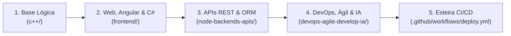

<div align="center">

# 🎓 Atividades SENAC Joinville — Portfólio Técnico do Curso Jovem Programador

**Monorepo completo com a evolução prática da formação em Desenvolvimento de Sistemas: da lógica em Portugol e C++ a aplicações Full-Stack com React, Angular, Node.js, C# .NET, bancos SQL e pipelines CI/CD.**

[](./.github/workflows/deploy.yml)
[](./devops-agile-develop-ia/Digooow.github.io/readme.md)
[](./frontend/Agenda-Windows-Form/README.md)
[](./frontend/trabalho-framework-angular/readme.md)
[](./devops-agile-develop-ia/devops-abacaxi/README.md)
[](./node-backends-apis/AvaliacaoFinalNodeAPI/readme.md)
[](#%EF%B8%8F-arsenal-tecnol%C3%B3gico)
[](./c%2B%2B/README.md)

[🏆 Projetos em Destaque](#-vitrine-de-projetos-em-destaque) · [🌐 Repositórios Relacionados](#-ecossistema-de-reposit%C3%B3rios-no-github) · [🗺️ Mapa do Monorepo](#%EF%B8%8F-mapa-e-estrutura-do-monorepo) · [📚 Catálogo Completo](#-cat%C3%A1logo-completo-de-atividades) · [🚀 Como Executar](#-como-executar-os-principais-projetos)

</div>

---

## 🎯 Sobre este Monorepo

Este repositório centraliza projetos, avaliações, seminários e exercícios desenvolvidos ao longo do programa **Jovem Programador** na **Faculdade de Tecnologia SENAC Joinville (SC)**. Em vez de deixar os trabalhos dispersos, toda a jornada foi organizada por domínio técnico — preservando desde os primeiros algoritmos em **Portugol / C++** até sistemas **Full-Stack**, aplicações **Desktop C#**, **APIs REST com ORM**, projetos assistidos por **IA** e **esteiras automatizadas de CI/CD**.

---

## 🏆 Vitrine de Projetos em Destaque

> Os principais projetos do repositório reunidos aqui na página inicial para acesso imediato, sem ficarem escondidos em subpastas.

<table>
  <tr>
    <td width="50%" valign="top">
      <h3>🌐 Portfólio Interativo &amp; Esteira CI/CD</h3>
      <p><strong>Onde está:</strong> <a href="./devops-agile-develop-ia/Digooow.github.io/"><code>devops-agile-develop-ia/Digooow.github.io/</code></a></p>
      <p>Aplicação web narrativa em 5 capítulos com telemetria real da <strong>GitHub REST API v3</strong>, console CLI assíncrono no navegador (<code>ping</code>, <code>inspect</code>, <code>git log</code>, <code>repos</code>), partículas procedurais em Canvas 2D com CSPRNG e esteira DevOps completa em <a href="./.github/workflows/deploy.yml"><code>deploy.yml</code></a>.</p>
      <p><strong>Destaques:</strong> Quality Gate SAST (<code>html-validate</code> + <code>node --check</code>), Actions fixadas por SHA, deploy automático no <strong>Cloudflare Pages</strong> via Wrangler e auditoria pós-deploy com <strong>Lighthouse CI</strong>.</p>
      <p>
        <a href="./devops-agile-develop-ia/Digooow.github.io/readme.md">📄 Ler README completo</a> ·
        <a href="./.github/workflows/deploy.yml">⚙️ Ver Workflow CI/CD</a>
      </p>
    </td>
    <td width="50%" valign="top">
      <h3>🍍 DevOps Abacaxi — Fazenda de Abacaxis</h3>
      <p><strong>Onde está:</strong> <a href="./devops-agile-develop-ia/devops-abacaxi/"><code>devops-agile-develop-ia/devops-abacaxi/</code></a></p>
      <p>Sistema <strong>Full-Stack</strong> de gestão de colheitas e vendas projetado para deploy gratuito no Render (<code>Static Site</code> + <code>Web Service</code> + <code>PostgreSQL</code>), com orquestrador local (<code>dev.js</code>) para MySQL em Docker.</p>
      <p><strong>Destaques:</strong> Front-end React 18 com tema interativo da <strong>Fenda do Biquíni</strong> em Canvas/SVG, suporte a <strong>3 idiomas (PT / EN / ZH)</strong>, Design System documentado, API Express 5 + Sequelize, JWT e documentação <strong>Swagger UI (<code>/docs</code>)</strong>.</p>
      <p>
        <a href="./devops-agile-develop-ia/devops-abacaxi/README.md">📄 README</a> ·
        <a href="./devops-agile-develop-ia/devops-abacaxi/abacaxi-backend/README.md">🔌 Backend</a> ·
        <a href="./devops-agile-develop-ia/devops-abacaxi/abacaxi-frontend/README.md">🎨 Frontend</a> ·
        <a href="./devops-agile-develop-ia/devops-abacaxi/abacaxi-frontend/STYLEGUIDE.md">📐 Styleguide</a>
      </p>
    </td>
  </tr>
  <tr>
    <td width="50%" valign="top">
      <h3>🅰️ Angular Interactive Showcase &amp; Toolkit</h3>
      <p><strong>Onde está:</strong> <a href="./frontend/trabalho-framework-angular/"><code>frontend/trabalho-framework-angular/</code></a></p>
      <p>SPA didática e autoexplicativa em <strong>Angular 21.2</strong>, TypeScript 5.9 e <em>Standalone Components</em> que demonstra ao vivo os motores internos do framework por meio de <strong>Cards Dinâmicos de Diagnóstico</strong>.</p>
      <p><strong>Destaques:</strong> Reatividade granular com <strong>Signals</strong> (<code>signal</code>, <code>computed</code>), os 4 pilares de Data Binding, novo Control Flow (<code>@if</code>, <code>@for</code>, <code>@switch</code>, <code>@empty</code>), Pipes, Formulários Reativos, ciclo de vida com DI, SSR e testes com <strong>Vitest</strong>, além de slides PDF e roteiro de 30 min.</p>
      <p>
        <a href="./frontend/trabalho-framework-angular/readme.md">📄 Ler README do Seminário</a> ·
        <a href="./frontend/trabalho-framework-angular/projeto-seminario/README.md">💻 App Angular</a> ·
        <a href="./frontend/trabalho-framework-angular/ORGANIZACAO_SOFTWARE.md">🏗️ Arquitetura</a>
      </p>
    </td>
    <td width="50%" valign="top">
      <h3>📮 Sistema ViaCEP Full-Stack MVC &amp; Testes</h3>
      <p><strong>Onde está:</strong> <a href="./frontend/atividade-api-cep-web-/"><code>frontend/atividade-api-cep-web-/</code></a></p>
      <p>Aplicação Full-Stack de cadastro e consulta de endereços integrada à API pública do <strong>ViaCEP</strong>, estruturada em arquitetura <strong>MVC</strong> tanto no front-end (ES Modules) quanto no back-end em Node.js + Express 4.</p>
      <p><strong>Destaques:</strong> Prevenção de duplicidade (<code>HTTP 409</code>), validação de CEP e das 27 UFs brasileiras, filtro acento-insensível e paginação no histórico JSON, limite de payload (<code>10 KB</code>) e <strong>7 suítes de testes automatizados</strong> com <code>node:test</code> nativo.</p>
      <p>
        <a href="./frontend/atividade-api-cep-web-/README.md">📄 Ler README completo</a> ·
        <a href="./frontend/atividade-api-cep-web-/test/">🧪 Ver Suíte de Testes</a>
      </p>
    </td>
  </tr>
  <tr>
    <td width="50%" valign="top">
      <h3>🔭 Diário do Cosmos — NASA APOD</h3>
      <p><strong>Onde está:</strong> <a href="./devops-agile-develop-ia/devops-nasa/"><code>devops-agile-develop-ia/devops-nasa/</code></a></p>
      <p>Galeria astronômica responsiva (<em>mobile-first</em>) que consome a API oficial da <strong>NASA APOD</strong> desde 16/06/1995, desenvolvida com engenharia guiada por instruções para o GitHub Copilot.</p>
      <p><strong>Destaques:</strong> Padrão <strong>BFF Proxy</strong> em Express 4 protegendo a <code>NASA_API_KEY</code> em <code>.env</code>, cache em memória no servidor, suporte a imagens HD e vídeos <code>16:9</code>, prevenção de XSS (<code>textContent</code>) e registro técnico das interações com IA.</p>
      <p>
        <a href="./devops-agile-develop-ia/devops-nasa/README.md">📄 Ler README completo</a> ·
        <a href="./devops-agile-develop-ia/devops-nasa/INTERACOES_COPILOT.md">🤖 Interações Copilot</a>
      </p>
    </td>
    <td width="50%" valign="top">
      <h3>📇 Agenda Desktop — C# .NET 10, WinForms &amp; SQLite</h3>
      <p><strong>Onde está:</strong> <a href="./frontend/Agenda-Windows-Form/"><code>frontend/Agenda-Windows-Form/</code></a></p>
      <p>Aplicação desktop para Windows construída em <strong>C# (.NET 10)</strong> com interface gráfica em <strong>Windows Forms</strong> e persistência local automática em banco <strong>SQLite</strong>.</p>
      <p><strong>Destaques:</strong> CRUD completo com queries SQL parametrizadas (protegidas contra SQL Injection), busca combinada por nome/telefone, máscara <code>(00) 00000-0000</code>, camada isolada de validação e testes automatizados em <strong>MSTest</strong>.</p>
      <p>
        <a href="./frontend/Agenda-Windows-Form/README.md">📄 Ler README completo</a> ·
        <a href="./frontend/Agenda-Windows-Form/Agenda.Tests/">🧪 Ver Testes MSTest</a>
      </p>
    </td>
  </tr>
</table>

---

## 🌐 Ecossistema de Repositórios no GitHub

Além das atividades hospedadas diretamente neste monorepo, parte dos projetos integradores, desafios de algoritmos e bootcamps do autor está publicada em repositórios dedicados:

| Repositório / Link | Tema Principal | Stack &amp; Foco | Referência no Monorepo |
| :--- | :--- | :--- | :--- |
| [**Projeto-Integrador2**](https://github.com/Digooow/Projeto-Integrador2) | Sistema de Reserva de Salas (Projeto Integrador II) | C#, .NET, API REST, JWT, SQL, Front-End Web, Sprints &amp; Testes E2E | Documentado em [`devops-agile-develop-ia/README.md`](./devops-agile-develop-ia/README.md) |
| [**Projeto-Integrador-SENAC-JOINVILLE**](https://github.com/Digooow/Projeto-Integrador-SENAC-JOINVILLE) | Projeto Integrador I — Fundação Arquitetural | C#, .NET, SQL e arquitetura em camadas | Referenciado em [`Digooow.github.io`](./devops-agile-develop-ia/Digooow.github.io/index.html) |
| [**LeetCode**](https://github.com/Digooow/LeetCode) | Resoluções de Algoritmos e Estruturas de Dados | C++17, STL, grafos, árvores e análise de complexidade Big-O | Referenciado em [`Digooow.github.io`](./devops-agile-develop-ia/Digooow.github.io/index.html) |
| [**dio-xp-inc-full-stack-developer**](https://github.com/Digooow/dio-xp-inc-full-stack-developer) | Bootcamp Full-Stack Developer XP Inc. | C#, .NET, React, JavaScript e HTML/CSS | Referenciado em [`Digooow.github.io`](./devops-agile-develop-ia/Digooow.github.io/index.html) |
| [**1-lh_nautical_csv**](https://github.com/Digooow/1-lh_nautical_csv) | Desafio Lighthouse Indicium — Dados Náuticos | Python, Pandas, Jupyter Notebook e SQL | Referenciado em [`Digooow.github.io`](./devops-agile-develop-ia/Digooow.github.io/index.html) |
| [**Perfil GitHub @Digooow**](https://github.com/Digooow) | Catálogo completo de repositórios do autor | Portfólio público e histórico de contribuições | — |

---

## 🗺️ Mapa e Estrutura do Monorepo



```text
Atividades-Senac-Joinville/
├── .github/
│   └── workflows/
│       └── deploy.yml                           # Pipeline CI/CD (Quality Gate, Cloudflare Pages, Lighthouse CI)
├── c++/                                         # Portugol, algoritmos C++, testes unitários e refatoração SOLID
│   ├── Atividades Portugol/                     # Algoritmos iniciais (.visualg)
│   ├── Atividades algoritmos/                   # Lista de exercícios práticos em C++
│   ├── Atividade Avaliativa C++ Prof Claudia/   # Avaliação de lógica em console C++
│   ├── Atividade Avaliativa Teste de Qualidade/ # Asserções unitárias, SOLID e entrega teórica (.pdf)
│   └── README.md
├── devops-agile-develop-ia/                     # DevOps, Metodologias Ágeis, Git/GitHub e Projetos com IA
│   ├── Digooow.github.io/                       # Portfólio interativo com telemetria GitHub + Terminal CLI
│   ├── devops-abacaxi/                          # Full-Stack React 18 + Express 5 + Sequelize + Swagger (Render)
│   ├── devops-nasa/                             # Diário do Cosmos (NASA APOD) com BFF Proxy seguro
│   ├── aula-exemplo-ia/                         # Biblioteca API REST nativa (node:http) + Front-End dark mode
│   ├── Atividade GitHub/                        # Tutorial completo de Git e publicação no GitHub
│   └── README.md                                # Índice do módulo + Metodologias Ágeis (Projeto Integrador 2)
├── frontend/                                    # Interfaces Web, SPA Angular 21, Full-Stack ViaCEP e Desktop C#
│   ├── trabalho-framework-angular/              # Seminário Angular 21 + SPA Showcase (projeto-seminario/)
│   ├── atividade-api-cep-web-/                  # Sistema ViaCEP Full-Stack MVC + 7 suítes node:test
│   ├── Agenda-Windows-Form/                     # Desktop C# .NET 10 + Windows Forms + SQLite + MSTest
│   └── Desenvolvimento-Web/                     # HTML5, CSS3, Bootstrap (Calculadora), JS, Figma, UX/UI e Cisco
├── node-backends-apis/                          # Back-ends e APIs REST em Node.js & Express (MVC e Sequelize)
│   ├── AvaliacaoFinalNodeAPI/                   # API multi-recurso (Clientes & Atendimentos) + PostgreSQL
│   ├── recuperacao-node/                        # API CRUD de Pessoas com Sequelize ORM + PostgreSQL
│   ├── exercicio-api-backend-senac/             # API REST de Marcas em camadas MVC (em memória)
│   ├── recuperacao-da-recuperacao/              # API REST de Filmes com alternância de status (em memória)
│   ├── avaliacao-node-api2/                     # Avaliação 2: API REST de Filmes em Express 5 + Postman
│   └── lista-exercicios-logica-programacao/     # 35 exercícios de lógica + 11 rotas POST em Express
├── .gitignore
├── .markdownlint.json
└── README.md                                    # Documentação principal do monorepo
```

---

## 📚 Catálogo Completo de Atividades

Abaixo está o resumo de **todas** as atividades organizadas por trilha, com link direto para a pasta e para o `README` específico de cada projeto.

### 1. DevOps, Metodologias Ágeis &amp; Desenvolvimento com IA (`devops-agile-develop-ia/`)

> Índice geral do módulo e diário ágil completo em [`devops-agile-develop-ia/README.md`](./devops-agile-develop-ia/README.md).

| Atividade / Projeto | Resumo da Entrega | Tecnologias | README |
| :--- | :--- | :--- | :--- |
| [**Digooow.github.io**](./devops-agile-develop-ia/Digooow.github.io/) | Portfólio estático em 5 capítulos com sincronização paginada da API do GitHub (repos autorais/forks e proporção de linguagens), terminal CLI assíncrono (`help`, `devops`, `repos`, `git log`, `ping`, `inspect`) e pipeline automática no Cloudflare Pages com Quality Gate e Lighthouse CI. | HTML5, Tailwind CSS, ES Modules, Canvas 2D, GitHub Actions, Wrangler, Lighthouse CI | [readme.md](./devops-agile-develop-ia/Digooow.github.io/readme.md) |
| [**devops-abacaxi**](./devops-agile-develop-ia/devops-abacaxi/) | Sistema de controle da *Fazenda de Abacaxis* (login JWT, colheitas, vendas com trava de estoque e painel). Front-end temático da *Fenda do Biquíni* com animações Canvas/SVG e 3 idiomas (PT/EN/ZH); back-end com Sequelize dual (MySQL Docker local / PostgreSQL Render) e Swagger `/docs`. | React 18, Vite 6, i18n, Express 5, Sequelize 6, JWT, Swagger, Docker | [README.md](./devops-agile-develop-ia/devops-abacaxi/README.md) · [Backend](./devops-agile-develop-ia/devops-abacaxi/abacaxi-backend/README.md) · [Frontend](./devops-agile-develop-ia/devops-abacaxi/abacaxi-frontend/README.md) |
| [**devops-nasa**](./devops-agile-develop-ia/devops-nasa/) | *Diário do Cosmos*: consumo da API NASA APOD com navegação por datas (desde 1995), data aleatória, cache em servidor e proteção da chave de API via proxy Express (`BFF`), construído a partir de regras do Copilot (`INTERACOES_COPILOT.md`). | Node.js 18+, Express 4, HTML5, CSS3 Mobile-First, GitHub Copilot | [README.md](./devops-agile-develop-ia/devops-nasa/README.md) |
| [**aula-exemplo-ia**](./devops-agile-develop-ia/aula-exemplo-ia/) | Aplicação didática de Biblioteca sem dependências externas (`node_modules`): servidor HTTP nativo (`node:http`) com CRUD em `/livros` e cliente web dark mode com painel de inspeção JSON de requisições/respostas em tempo real. | Node.js (`node:http`), HTML5, CSS3, Fetch API | [readme.md](./devops-agile-develop-ia/aula-exemplo-ia/readme.md) |
| [**Atividade GitHub**](./devops-agile-develop-ia/Atividade%20GitHub/) | Guia prático de configuração do Git (`user.name`, `user.email`), inicialização de repositório local, commits, criação de repositório remoto e publicação via `git push` com PAT/SSH/CLI. | Git, GitHub, CLI | [readme.md](./devops-agile-develop-ia/Atividade%20GitHub/readme.md) |
| [**Metodologias Ágeis — PI 2**](./devops-agile-develop-ia/README.md) | Documentação do processo ágil do **Projeto Integrador 2** (*Sistema de Reserva de Salas*): identificação de usuários, histórias de usuário, backlog priorizado, 5 sprints (10 aulas), retrospectiva e link para o sistema completo. | Scrum, Kanban, Histórias de Usuário, Backlog | [README.md](./devops-agile-develop-ia/README.md) · [Repo PI 2](https://github.com/Digooow/Projeto-Integrador2) |

---

### 2. Front-End, Frameworks &amp; Aplicações Desktop (`frontend/`)

| Atividade / Projeto | Resumo da Entrega | Tecnologias | README |
| :--- | :--- | :--- | :--- |
| [**trabalho-framework-angular**](./frontend/trabalho-framework-angular/) | Seminário completo de Angular (slides PDF, roteiro de 30 min, organização técnica) + SPA **Angular Interactive Showcase &amp; Toolkit** com 6 cards interativos (Data Binding, Signals, Control Flow `@if`/`@for`/`@switch`, Pipes, Formulários Reativos e Ciclo de Vida com DI). | Angular 21.2, TypeScript 5.9, Signals, SSR, Vitest | [readme.md](./frontend/trabalho-framework-angular/readme.md) · [App Angular](./frontend/trabalho-framework-angular/projeto-seminario/README.md) |
| [**atividade-api-cep-web-**](./frontend/atividade-api-cep-web-/) | Cadastro e consulta de endereços com busca automática na API ViaCEP, arquitetura MVC no navegador e no servidor Express, persistência em JSON, detecção de duplicidade (`409`), paginação e **7 suítes de testes automatizados** (`node:test`). | HTML5, CSS3, ES Modules, Node.js, Express 4, ViaCEP, `node:test` | [README.md](./frontend/atividade-api-cep-web-/README.md) |
| [**Agenda-Windows-Form**](./frontend/Agenda-Windows-Form/) | Aplicação desktop de agenda de contatos em C# com WinForms e SQLite criado automaticamente, validação de regras de negócio (`ContactValidator`), queries SQL parametrizadas, máscara de telefone e suíte de testes em MSTest. | C#, .NET 10, Windows Forms, SQLite, MSTest | [README.md](./frontend/Agenda-Windows-Form/README.md) |
| [**Desenvolvimento-Web**](./frontend/Desenvolvimento-Web/) | Coleção com 7 frentes de front-end: **Calculadora Web** em Bootstrap 5.3.8 + JS (`Atividade Calculadora/`), **Formulário JS** com validação e acessibilidade ARIA, **Site baseado em Figma** (*Cafeteria da ria*), **Site HTML sem IA** (*Digooow's Portfólio*), **Atividade 1** (9 páginas HTML), **Atividade UX/UI** (PDF) e **Curso HTML Essentials Cisco** (*Indoor Plants* e *Taste of Travel*). | HTML5, CSS3, Bootstrap 5.3.8, JavaScript DOM, Figma, UX/UI | [README.md](./frontend/Desenvolvimento-Web/README.md) |

---

### 3. Back-End &amp; APIs REST com Node.js (`node-backends-apis/`)

| Atividade / Projeto | Resumo da Entrega | Persistência &amp; Stack | README |
| :--- | :--- | :--- | :--- |
| [**AvaliacaoFinalNodeAPI**](./node-backends-apis/AvaliacaoFinalNodeAPI/) | Avaliação final de Node.js implementando dois CRUDs em camadas MVC: **Clientes** (`/api/cliente/*` com `nome`, `email`, `senha`) e **Atendimentos** (`/api/atendimento/*` com `data`, `valor`, `concluido`). | Node.js, Express 5, Sequelize 6, PostgreSQL (`pg`) | [readme.md](./node-backends-apis/AvaliacaoFinalNodeAPI/readme.md) |
| [**recuperacao-node**](./node-backends-apis/recuperacao-node/) | API REST de cadastro de **Pessoas** (`nome` e `idade`) em arquitetura MVC conectada a banco relacional PostgreSQL via Sequelize ORM e configuração por variáveis de ambiente. | Node.js, Express 5, Sequelize 6, PostgreSQL (`pg`) | [README.md](./node-backends-apis/recuperacao-node/README.md) |
| [**exercicio-api-backend-senac**](./node-backends-apis/exercicio-api-backend-senac/) | API REST de **Marcas de Veículos** (`/api/marcas`) com 5 operações CRUD em array em memória e documentação didática linha a linha do fluxo `Router → Controller → Service → Model`. | Node.js, Express 5, ES Modules, MVC | [README.md](./node-backends-apis/exercicio-api-backend-senac/README.md) |
| [**recuperacao-da-recuperacao**](./node-backends-apis/recuperacao-da-recuperacao/) | API REST de catálogo de **Filmes** (pré-populada com a trilogia *O Poderoso Chefão*) com 6 rotas sob `/api`, incluindo `/api/alterarstatus/:id` e arquitetura MVC em memória. | Node.js, Express 5.3, ES Modules, MVC | [readme.md](./node-backends-apis/recuperacao-da-recuperacao/readme.md) |
| [**avaliacao-node-api2**](./node-backends-apis/avaliacao-node-api2/) | Segunda avaliação de API REST em Node.js gerenciando filmes em `/api/filmes` com estrutura em `source/` (`Controller`, `Model`, `Router`, `Services`) e workspace Postman. | Node.js, Express 5, ES Modules, Postman | [readme.md](./node-backends-apis/avaliacao-node-api2/readme.md) |
| [**lista-exercicios-logica-programacao**](./node-backends-apis/lista-exercicios-logica-programacao/) | Lista completa com **35 exercícios + 8 desafios** de lógica de programação, acompanhada de servidor Express em `index.js` que implementa os Exercícios 1–8 e Desafios 0–2 como **11 rotas `POST`**. | Node.js, Express 5, JavaScript | [README.md](./node-backends-apis/lista-exercicios-logica-programacao/README.md) |

---

### 4. Lógica de Programação, Algoritmos, C++ &amp; Qualidade de Software (`c++/`)

> Documentação completa e comandos de compilação em [`c++/README.md`](./c%2B%2B/README.md).

| Subpasta | Conteúdo | Destaques | Link |
| :--- | :--- | :--- | :--- |
| **Atividades Portugol** | 7 arquivos `.visualg` (calculadora, tabuada, par/ímpar, mês por número, classificação de nota, número premiado) | Fundamentos de algoritmo e pseudocódigo antes de linguagens compiladas | [`c++/Atividades Portugol/`](./c%2B%2B/Atividades%20Portugol/) |
| **Atividades algoritmos** | 6 programas em C++ (`111.cpp` a `116.cpp`) | Loops `while`/`for`, validação de entrada, média escolar e simulação de caixa de padaria | [`c++/Atividades algoritmos/`](./c%2B%2B/Atividades%20algoritmos/) |
| **Atividade Avaliativa C++ Prof Claudia** | 3 versões evolutivas de atividade avaliativa em console C++ | Lógica condicional, vetores e interação com usuário no console Windows | [`c++/Atividade Avaliativa C++ Prof Claudia/`](./c%2B%2B/Atividade%20Avaliativa%20C%2B%2B%20Prof%20Claudia/) |
| **Atividade Avaliativa Teste de Qualidade** | 4 baterias de testes unitários em C++ + refatoração SOLID + PDF teórico (`Atividade Escrita Teste de qualidade.pdf`) | Transição para testes automatizados com asserções e aplicação dos princípios **SOLID** em C++ | [`c++/Atividade Avaliativa Teste de Qualidade/`](./c%2B%2B/Atividade%20Avaliativa%20Teste%20de%20Qualidade/) |

---

## 🛠️ Arsenal Tecnológico

| Categoria | Tecnologias e Ferramentas Praticadas |
| :--- | :--- |
| **Linguagens** | C#, TypeScript, JavaScript (ES6+ / ES Modules), C++, Portugol (Visualg), HTML5, CSS3, SQL |
| **Front-End &amp; Desktop** | Angular 21 (Signals, SSR), React 18, Vite 6, Tailwind CSS, Bootstrap 5.3, HTML5 Canvas 2D, SVG Inline, Windows Forms (.NET 10) |
| **Back-End &amp; APIs** | Node.js (`node:http` nativo e Express 4/5), Arquitetura MVC em camadas, BFF Proxy, JWT (`jsonwebtoken` + `bcryptjs`), Swagger / OpenAPI 3.0 |
| **Bancos de Dados &amp; ORM** | PostgreSQL (`pg`), MySQL (`mysql2`), SQLite (`System.Data.SQLite`), Sequelize ORM, Persistência em JSON |
| **Qualidade &amp; Testes** | `node:test` + `node:assert`, MSTest (.NET), Vitest (Angular), Testes Unitários em C++, `html-validate`, Refatoração SOLID |
| **DevOps, Cloud &amp; Metodologias** | Git &amp; GitHub, GitHub Actions (`deploy.yml`), Cloudflare Pages &amp; Wrangler, Render, Docker Compose, Lighthouse CI, Scrum &amp; Kanban |

---

## 🚀 Como Executar os Principais Projetos

Clone o repositório uma única vez:

```bash
git clone https://github.com/Digooow/Atividades-Senac-Joinville.git
cd Atividades-Senac-Joinville
```

| Projeto | Comando para Rodar Localmente | Endereço / Saída |
| :--- | :--- | :--- |
| **Portfólio &amp; Telemetria GitHub** | Sirva `devops-agile-develop-ia/Digooow.github.io` com `npx serve devops-agile-develop-ia/Digooow.github.io` ou Live Server | Navegador (ES Modules) |
| **DevOps Abacaxi (Full-Stack)** | `cd devops-agile-develop-ia/devops-abacaxi && npm run dev` *(com Docker aberto)* | Site `http://localhost:5173` · API `http://localhost:3001` · Swagger `/docs` |
| **SPA Angular 21** | `cd frontend/trabalho-framework-angular/projeto-seminario && npm install && npm start` | `http://localhost:4200` |
| **Sistema ViaCEP + Testes** | `cd frontend/atividade-api-cep-web- && npm install && npm test && npm start` | `http://localhost:3000` |
| **Diário do Cosmos (NASA)** | `cd devops-agile-develop-ia/devops-nasa && npm install && cp .env.example .env && npm start` | `http://localhost:3000` |
| **Agenda C# WinForms** | `cd frontend/Agenda-Windows-Form && dotnet test && dotnet run --project ./Agenda/Agenda.csproj` | Aplicação Desktop Windows |
| **Biblioteca (Zero Deps)** | `cd devops-agile-develop-ia/aula-exemplo-ia && node backend.js` | `http://localhost:3000` |
| **APIs Node.js** | Entre na pasta desejada em `node-backends-apis/`, rode `npm install` e `npm run dev` *(ou `node index.js`)* | `http://localhost:3000` |

---

<div align="center">

Desenvolvido por **Rodrigo da Cruz Godinho** ([@Digooow](https://github.com/Digooow)) · Programa **Jovem Programador** — **SENAC Joinville**

[](https://github.com/Digooow)
[](https://www.linkedin.com/in/digooow)
[](https://leetcode.com/digooow)

</div>
